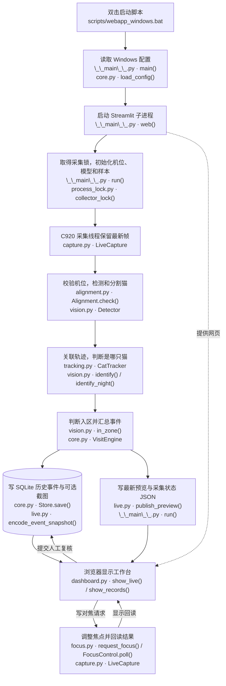
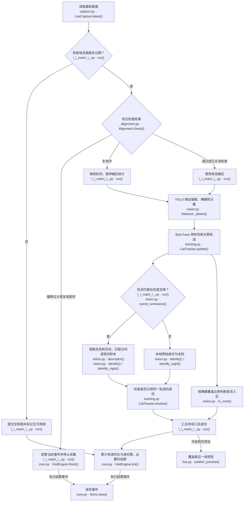
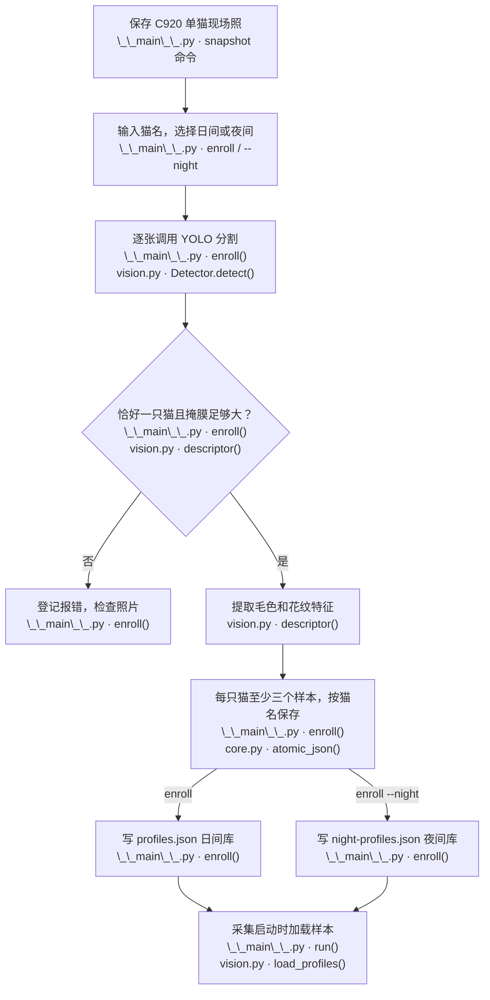
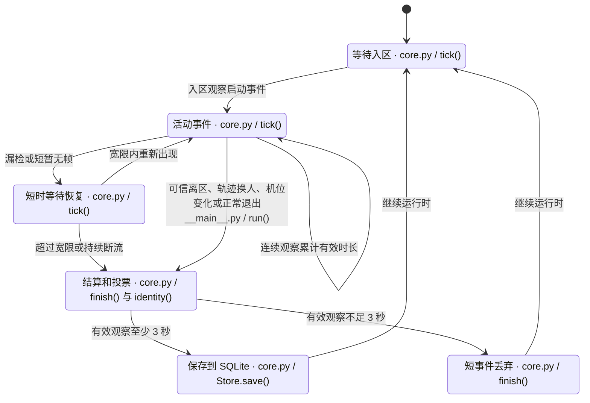

# 双猫监测项目代码学习指南

这份指南以 Windows 版为例，带你从 C920 的一帧画面读到 SQLite 的一条事件，再看到工作台怎么展示和复核。代码依据为 `main` 的 `76cce36`。当前系统记录的是**粮碗区域候选进食**，实际进食由人根据现场或画面复核。饮水、猫砂盆行为、多路采集和手机外网访问属于后续目标。[项目现状与启动说明](../PROJECT_STATUS.md) · [路线图](../ROADMAP.md)

第一次读，建议从**图 1 → 第 3、4、5、7 个代码块 → 第 3 节算例**开始。代码中的两只猫叫 `冲冲` 和 `白猫`，本文沿用配置名，方便对照输出。`unknown` 表示程序目前无法可靠归属身份。[Windows 配置](../config.windows.json#L30)

## 1. 先看整套系统怎么工作

流程框内标出负责该步骤的文件，关键步骤还标出函数。`dashboard.py` 位于项目根目录，其余图中的 `.py` 文件位于 `catwatch/`。图下的代码链接可以直接打开对应行。

### 图 1 · 从双击启动到浏览器显示

主进程运行采集与识别，另起一个 Streamlit 进程读预览和事件。关闭浏览器标签后采集会继续。关闭一体化启动终端或电脑休眠会中断监测。手机外网访问需要另行接入；这个入口绑定的是本机地址。[Windows 启动脚本](../scripts/webapp_windows.bat#L11) · [两个进程如何启动](../catwatch/__main__.py#L382) · [采集线程](../catwatch/capture.py#L31) · [实时看板](../dashboard.py#L33) · [对焦处理](../catwatch/focus.py#L29)

### 图 2 · 一帧画面怎么变成一条观察

读图时记住四个中间结果。**检测框**是一只猫的大致位置。**分割掩膜**是与画面对齐的像素标记。**轨迹编号**把多帧里连续出现的框串起来。**猫名**是样本匹配和事件综合判断的结果。[主循环](../catwatch/__main__.py#L198) · [机位检查](../catwatch/alignment.py#L167) · [检测输出](../catwatch/vision.py#L114) · [轨迹关联与身份沿用](../catwatch/tracking.py#L18) · [事件计时](../catwatch/core.py#L120)

## 2. 按代码块读项目

### ① 启动、配置与主循环

**入口**是 `python -m catwatch --config config.windows.json web`。Python 进入 `main()`，解析命令，读取 JSON，再把配置交给 `web()` 或 `run()`。`load_config()` 会把模型、数据库和样本库的相对路径解释为相对于配置文件所在目录，并验证两只猫的名字、粮区坐标以及部分阈值。`CATWATCH_SOURCE` 环境变量可以覆盖摄像头来源。[命令入口](../catwatch/__main__.py#L401) · [配置读取](../catwatch/core.py#L33) · [来源选择](../catwatch/__main__.py#L13)

| 命令 | 做什么 | 学习时看哪里 |
| --- | --- | --- |
| `setup` | 读取摄像头画面，手动画粮碗框，保存归一化坐标和机位参考 | [画框与释放相机](../catwatch/__main__.py#L17)、[保存配置](../catwatch/__main__.py#L422) |
| `snapshot` | 从摄像头保存一张校准照片，已存在的文件名会报错 | [保存照片](../catwatch/__main__.py#L435) |
| `enroll` | 从单猫照片提取特征并登记，`--night` 选择夜间库 | [参数分派](../catwatch/__main__.py#L452)、[登记实现](../catwatch/__main__.py#L74) |
| `doctor --model` | 检查 Python、OpenCV、PyTorch、CUDA，并用一张空画面试跑模型 | [环境自检](../catwatch/__main__.py#L48) |
| `run` | 运行识别，`--preview` 打开 OpenCV 窗口，`--video` 使用文件回放 | [监控入口](../catwatch/__main__.py#L121) |
| `web` | 同时运行采集与本机 Streamlit 工作台 | [一体化入口](../catwatch/__main__.py#L382) |
| `demo` | 生成三条模拟事件，写到独立演示库 | [模拟事件生成](../catwatch/__main__.py#L101) |

**知识点**是命令行参数、配置、库导入、循环、异常与进程。可以先把 `main()` 看成一个分派表，顺着 `web` 找到 `run()`，再从 `run()` 找到摄像头和模型的构造语句。[对象初始化](../catwatch/__main__.py#L121)

### ② 摄像头采集与断流重连

`open_capture()` 用 OpenCV 打开输入。Windows USB 摄像头优先走 DirectShow，以便操作 C920 的对焦控制。代码也有 RTSP 打开分支，为连接和读帧设置 5 秒超时。Windows 当前配置使用 USB `source: 0`，请求 1280×720、10 FPS，实际采集规格要看设备回报。[打开输入源](../catwatch/capture.py#L9) · [采集配置](../config.windows.json#L2)

`LiveCapture` 单开一条后台线程。每次读取成功，就在锁保护下覆盖同一个数据包。数据包有**帧序号、单调时钟、墙上时间和图像**。主循环取新序号并舍弃超过 2 秒的包，以约 2 FPS 为推理目标。这条路径不会为了补算而排队处理旧画面。读失败时释放摄像头，约 2 秒后再次尝试打开。[采集线程](../catwatch/capture.py#L45) · [取帧与回放取样](../catwatch/__main__.py#L173)

**知识点**是像素数组、线程、锁和两种时钟。单调时钟用来算间隔，墙上时间用于把画面或事件显示成日期时间。回放按帧号除以视频帧率计算时间，改变运行快慢仍可得到同一个媒体时间轴。[实时与回放时间](../catwatch/__main__.py#L182)

### ③ YOLO26n 检测与实例分割

项目的 YOLO 入口是 `vision.py` 的 `Detector`。`YOLO(c["model"])` 加载本机的 `data/yolo26n-seg.pt`，构造时检查任务为 `segment`，再从模型的类别表中找出 `cat`。模型实现随 `ultralytics` 包安装，项目里的 `Detector` 负责调用并整理输出。[依赖声明](../pyproject.toml#L6) · [模型加载](../catwatch/vision.py#L97) · [权重路径](../config.windows.json#L7)

每次 `_detect(frame)` 调用 `self.model.predict()`，只取 `cat` 类。它收集每只猫的框、掩膜和分数，再把掩膜调整到原画面大小，让后续可以按像素提取猫毛特征和计算粮区覆盖。`imgsz: 640` 是给模型的输入尺寸设置，`device: "0"` 指定第一张 GPU。`confidence: 0.45` 是当前项目判断猫检测是否可靠的门槛，单位是模型分数。[逐帧预测与掩膜处理](../catwatch/vision.py#L114) · [推理配置](../config.windows.json#L7)

ByteTrack 开启时，预测会先保留低至 `0.10` 的候选框供跟踪关联，低分框只有接上轨迹才可能过这一步。后续还会检查这个框能否延续当前粮区事件，且低分框不会生成新的分猫特征。预览右侧的猫名来自后面的身份模块。[检测分级](../catwatch/vision.py#L114) · [后续可信门槛](../catwatch/__main__.py#L248)

**知识点**是预训练模型、推理、检测置信度和实例分割。「实例」指同一张图里每只猫各有自己的框和掩膜。建议先读 `_detect()` 中 `r.boxes` 与 `r.masks` 的处理，再读 YOLO 内部的神经网络结构。[检测框和掩膜的对应关系](../catwatch/vision.py#L124)

### ④ ByteTrack 跟踪和短时身份沿用

`CatTracker.update()` 把前后帧的检测框作关联，输出**本帧检测序号 → 轨迹编号**。框的关联完成后，程序仍使用与这个检测序号配对的真实掩膜。高分框可以建立新轨迹。较低分的框用于尝试找回已有轨迹，因此一帧分数下降时，猫仍可能延续在同一段事件里。[跟踪器配置与关联](../catwatch/tracking.py#L6) · [在预测后使用轨迹](../catwatch/vision.py#L119)

`resolve()` 是项目自己的身份沿用规则。同一轨迹累计 3 次同名识别后，单猫场景里可以在最近有效身份的 5 秒内为未知帧沿用这个名字。新的相反匹配会立刻覆盖旧依据；一帧有多个检测时清空沿用依据。沿用结果标记为 `inherited`，事件不会把它当作一张新的同名票。轨迹编号有助于判断连续性，样本匹配才提供猫名依据。[沿用规则](../catwatch/tracking.py#L26) · [投票规则](../catwatch/core.py#L135)

**知识点**是时间上的关联、低分检测、缓存失效与证据独立性。想理解「先认对、过几秒又未知」时，先问本帧有没有猫框，再问轨迹是否连续，最后看原始身份 `raw_cat` 和是否沿用 `inherited`。[预览结果字段](../catwatch/__main__.py#L273)

### ⑤ 毛色、花纹与日夜身份匹配

`descriptor(frame, mask)` 只提取猫掩膜内的像素。它先用 LAB 颜色把猫毛画成一张 **512 格颜色分布表**，再拼上 **26 个相对明暗和分块特征**。后一部分用该帧猫毛中较亮的像素做参考，并把猫的位置范围分成 3×3 格。掩膜小于 200 像素时放弃抽取。这些数字描述的是画面里的外观，也是样本库保存的数据。[提取颜色与花纹](../catwatch/vision.py#L12)

| 环节 | 当前代码怎么判 | 读代码时注意什么 |
| --- | --- | --- |
| 判断灯光 | 缩小全帧并取灰度中位数。Windows 配置下大于 75 走日间，24–75 走夜间，低于 24 缺少生成新身份特征的光照 | 看的是**画面亮度**。夜间模式由配置有夜间样本路径和画面亮度触发。[亮度计算](../catwatch/vision.py#L68) · [模式选择](../catwatch/__main__.py#L240) |
| 日间匹配 | 分别找每只猫最接近的颜色样本，最佳距离不超过 `0.55`，领先至少 `0.12`，再检查有无强烈冲突的花纹依据 | 距离越小越像。两只猫分数接近，或可靠花纹指向另一只猫时会保留未知。[日间实现](../catwatch/vision.py#L44) |
| 夜间匹配 | 分别比颜色和相对花纹，两项都要指向同一只猫。两项平均距离最多 `0.11`，领先至少 `0.035` | 需要两只猫都提供含花纹特征的夜间样本。当前这两个夜间距离门槛写在代码里。[夜间实现](../catwatch/vision.py#L73) |

**知识点**是颜色空间、直方图、特征向量、最近样本和阈值。想验证「白脖子」「头部花色」有没有帮助，从这里理解当前特征覆盖了哪些像素，再用相同测试录像比较错名率与未知率。[颜色与花纹回归测试](../tests/test_vision.py)

### ⑥ 样本采集、登记与加载

日间样本库是 `data/profiles.json`，夜间是 `data/night-profiles.json`。`snapshot` 获取一张照片。`enroll` 对每张照片调用同一个 YOLO 分割器，要求恰好检出一只猫，再调用 `descriptor()`。每只猫每个模式至少 3 张，同一个名字再次登记会替换该猫在该库中的特征列表。采集程序启动时加载日夜库，两只猫的名字必须与配置对应。登记会更新样本特征，原有 `yolo26n-seg.pt` 仍是检测用的模型权重。[样本登记](../catwatch/__main__.py#L74) · [样本库加载](../catwatch/vision.py#L135) · [夜间命令](../catwatch/__main__.py#L452)

**图 3 · 单猫照片怎么变成日夜样本库**

**知识点**是数据标签、样本库、模型权重与评估集。学习时可以用同一段未参与登记的夜间录像，比较两套样本库的结果。保留原始样本清单，才能知道效果变化来自补充样本还是改动了规则。[状态文档中的校准步骤](../PROJECT_STATUS.md#L80)

### ⑦ 粮区判断与事件状态机

粮区是归一化的 `[x1, y1, x2, y2]`。`in_zone()` 量的是**框内猫掩膜像素数 ÷ 整只猫掩膜像素数**。例如整只猫有 1,000 个像素，其中 100 个落在粮区，覆盖率就是 10%，通过 Windows 的 8% 门槛。低分目标只可以用同一个已知粮区轨迹延续正在进行的事件。[覆盖率计算](../catwatch/vision.py#L153) · [入区判断](../catwatch/__main__.py#L254) · [粮区配置](../config.windows.json#L13)

`VisitEngine.tick()` 接收时间、粮区身份列表、日夜模式及画面可用状态。第一次入区开一个活动事件。相邻两次都有入区观察时，才累计这两次的间隔，单步上限是 `1.5 / inference_fps`，Windows 当前是 0.75 秒。两次观察之间若有漏检或无帧，空档不会计入有效观测。事件结束时用最后一次有效入区观察作为结束时间。[状态机主逻辑](../catwatch/core.py#L120) · [事件结算](../catwatch/core.py#L170)

**图 4 · 一次到访如何变成数据库事件**

| 决策 | Windows 当前规则 |
| --- | --- |
| 什么时候拆段 | 可信检测确认原轨迹离区时可立即结算；粮区换成明确的另一个轨迹时拆分。普通漏检按事件开始时的模式等待，日间 3 秒、夜间 10 秒。持续无帧按普通 3 秒门槛结算；直播旧包还会先经过 2 秒的新鲜度保护。 |
| 什么时候存储 | 有效观测达到 3 秒才写入候选事件。事件进行中的状态留在内存，正常退出会处理达到门槛的活动事件。 |
| 事件归给谁 | 赢得最多票的名字需至少 3 票，并达到日间 80% 或夜间 60% 的投票占比。入区但身份未知会进入分母，沿用身份不会新增同名票。两猫同处粮区或事件里出现相互冲突的猫名时，归为 `unknown`。 |
| 什么时候附截图 | 累计至少 5 秒有效观测，当前只有一个入区身份且与事件已确认身份相符；启用跟踪时还需要有轨迹编号。截图先附到活动事件，结算时写入数据库。 |

**知识点**是状态机、时间窗口、身份投票和「候选事件」的定义。`0.45` 用于逐帧猫检测，`8%` 用于入区，`80%`／`60%` 用于给整段事件归属。这些是三项独立判断。[主循环的离区与拆段](../catwatch/__main__.py#L259) · [事件投票与截图门槛](../catwatch/core.py#L149) · [阈值配置](../config.windows.json#L19)

### ⑧ 机位校验和粮区修正

手动 `setup` 保存一张粮碗无遮挡的基准图和区域坐标。`Alignment` 在启用检查时先检查，再约每小时复查。在基准图的粮区外抽取 SIFT 特征点，用匹配点和 RANSAC 估计画面平移、旋转及尺度变化，再在预测位置周围匹配粮碗模板。[保存基准](../catwatch/alignment.py#L66) · [估算机位变化](../catwatch/alignment.py#L82) · [定位粮碗](../catwatch/alignment.py#L123)

代码给出的有效偏移小于 2% 时保留基准框，中等偏移且匹配成功时更新蓝框，任一偏移指标达到 20% 时停止。无法确认时暂时暂停粮区统计，约每 10 秒重试，持续 120 秒仍无法确认则停止。主循环在机位失效或区域变化时也会结算当前事件，以免跨两个区域累加。[机位判定流程](../catwatch/alignment.py#L167) · [主循环联动](../catwatch/__main__.py#L214)

**知识点**是参考图、特征匹配、坐标变换和失败恢复。相机歪了先看机位检查状态，夜间认错先看身份特征。实际排查时可以同时观察蓝框和猫框，判断偏差从哪一步开始。[机位测试](../tests/test_alignment.py)

### ⑨ USB 摄像头对焦

工作台的滑块提交自动或手动对焦请求，带上唯一请求编号，写入 `status.focus-request.json`。持有 C920 的采集线程约每 0.5 秒检查请求，尝试应用后从设备读回焦点值和模式，再把结果写入 `status.focus-result.json`。手动范围 0–250 是驱动的档位。看板比较请求和响应编号，显示等待、成功回读或设备拒绝。[发出请求与执行](../catwatch/focus.py#L29) · [采集线程调用](../catwatch/capture.py#L45) · [工作台状态](../dashboard.py#L114)

**知识点**是硬件接口、请求/响应、轮询和跨进程通信。移动滑块是在给镜头设置焦点，目的是让猫毛及碗边清楚；粮区位置另由机位代码维护。[焦点回读实现](../catwatch/focus.py#L54)

### ⑩ 数据保存、预览和人工复核

| 数据流 | 生产者 → 消费者 | 用来回答什么 |
| --- | --- | --- |
| `data/status.json` | `run()` 约每 2 秒写采集状态 → 工作台读取 | 摄像头是否在线？当前日间还是夜间？程序处理了多少帧？ [状态写入](../catwatch/__main__.py#L328) |
| `data/status.live.json` | `publish_preview()` 覆盖最新 JPEG 和检测条目 → `show_live()` | 现在画面是什么，绿框和蓝框在哪里？JPEG 以 Base64 字符串放进 JSON，超过 4 秒的预览会被忽略。 [预览读写](../catwatch/live.py#L11) |
| `data/events.sqlite3` | `Store.save()` 写已结算事件及可选截图 → `show_records()` 查历史 | 哪天有多少次候选事件，观察了多少秒？SQLite 使用 WAL，便于采集写入时看板同时读取。 [数据库结构](../catwatch/core.py#L72) · [事件查询](../dashboard.py#L154) |
| `events.review`、`events.reviewed_cat` | 工作台保存人工判断 → 工作台重算事件归属和统计 | 人看到的是确实进食、未进食还是无法判断？模型原始 `cat` 字段仍可在事件明细中对照。 [复核写入](../dashboard.py#L221) |

工作台的「候选进食」汇总排除人工标为未进食的事件，「确认进食」只计人工确认。日柱状图与 CSV 使用当期查询到的事件明细，也会带上被复核否决的行；核对数字时要看筛选口径。事件截图按需读取。页面标题、统计分组和复核选项都使用配置中的猫名。[汇总与 CSV](../dashboard.py#L179) · [截图查询](../dashboard.py#L208)

**知识点**是表与字段、SQL、事务、JSON、JPEG 和前后端边界。先从工作台选中一条事件，再去读 `Store` 表结构，找 `observed_seconds`、`cat`、`reviewed_cat`、`end_reason` 和 `snapshot_ts`。这几个字段能分别回答时长、机器判定、人工修正、结束原因和截图时间。[事件字段](../catwatch/core.py#L77)

### ⑪ 自动测试与现场验收

| 测试文件 | 能学到的检测方法 |
| --- | --- |
| [test_core.py](../tests/test_core.py) | 直接送入带时间的观察，断言事件拆分、漏检计时、身份投票、截图门槛和并发读写。 |
| [test_vision.py](../tests/test_vision.py) | 用可控图像和掩膜比较颜色与花纹，检查背景排除、面积门槛和夜间冲突。 |
| [test_tracking.py](../tests/test_tracking.py) | 用确定的检测框和分数，验证低分续轨、身份沿用和两猫同时出现时的清除规则。 |
| [test_alignment.py](../tests/test_alignment.py) | 人工平移画面、遮挡碗、模拟大幅偏移，检查蓝框更新、暂停与停机边界。 |
| [test_pipeline.py](../tests/test_pipeline.py) | 用合成录像和替身检测器验证回放时间、两猫事件及截图入库。真实 YOLO 检出率要用真实录像测。 |
| [test_dashboard.py](../tests/test_dashboard.py) · [test_portability.py](../tests/test_portability.py) | 验证汇总、复核，以及进程锁、路径、编码和 Windows 配置。 |

**知识点**是 `pytest`、断言、替身和回归。自动测试适合回答「代码是否符合写下来的规则」。要回答「夜间能否稳定分猫」，给独立录像标记每次真的进食、两只猫的身份、开始和结束时间，再对照错名、未知、漏记和重复计数。[测试运行与现场验收](../PROJECT_STATUS.md#L92)

### ⑫ 安装、运行保护和数据边界

`install_windows.bat` 建 Python 3.12 虚拟环境，安装 CUDA 12.8 对应的 PyTorch、项目依赖及 pytest，再跑环境检查和测试。`process_lock.py` 用数据库旁的锁文件避免两个采集进程同时写同一份活动数据。机位开关和对焦请求分别用自己的锁保护并发写入。状态 JSON 先写临时文件再替换，Windows 上短暂写入冲突可以重试。[安装脚本](../scripts/install_windows.bat) · [文件锁](../catwatch/process_lock.py#L9) · [状态写入](../catwatch/core.py#L14)

GitHub 保存源码和配置。本地 `data/` 保存模型权重、猫照、家庭画面、样本特征、数据库和截图。离线回放用独立配置与独立数据库，防止测试记录混入日常统计。重新启动会加载已有历史库，但活动事件的中途状态仅保存在进程内，异常掉电后的自动重启与未结算事件恢复仍属于后续工作。[忽略规则](../.gitignore) · [本机数据清单](../PROJECT_STATUS.md#L47) · [长期运行计划](../ROADMAP.md#整体路线图)

## 3. 跟着一次漏检算出数据库里的那条记录

下面用白天、单猫、2 FPS 举例。假设猫已稳定识别为冲冲、始终保持同一轨迹，最后一帧能可靠确认它离开了蓝框。这是按当前代码手算的示例，可对照状态机测试。[有效时长测试](../tests/test_core.py#L38) · [漏检续接测试](../tests/test_core.py#L56)

| 时间 | 程序看到什么 | 事件累计有效观测 |
| --- | --- | ---: |
| 0.0 秒 | 冲冲首次入区，建立事件 | 0.0 秒 |
| 0.5、1.0、1.5 秒 | 三次连续入区，每步累加 0.5 秒 | 1.5 秒 |
| 2.0 秒 | 漏检一次，仍在宽限期内 | 1.5 秒 |
| 2.5 秒 | 同一只猫重新检出，恢复观察 | 1.5 秒 |
| 3.0、3.5、4.0、4.5 秒 | 又有四个连续观察间隔 | 3.5 秒 |
| 5.0 秒 | 同一轨迹被可靠看见在粮区外，结算 | 3.5 秒 |

结果是**一条归给冲冲的候选进食**，记录用时从首次入区到最后一次入区是 4.5 秒，有效观测 3.5 秒。达到 3 秒入库门槛，尚未达到 5 秒截图门槛。那次真正漏检没有入区身份，也没有追加一张 `unknown` 票；如果当时猫框在区内但样本匹配失败，才会进入身份判断这条路径。[出区结算](../catwatch/__main__.py#L259) · [持续时长、投票与截图](../catwatch/core.py#L120)

## 4. 学习和排查顺序

| 想弄懂什么 | 从哪里开始 | 可以问自己的问题 |
| --- | --- | --- |
| 一次候选进食是怎么统计的 | [VisitEngine](../catwatch/core.py#L102) → [时长测试](../tests/test_core.py#L38) | 猫只路过两秒会怎样？短漏检和离区分别怎么处理？ |
| YOLO 到底提供了什么 | [配置里的模型](../config.windows.json#L7) → [Detector](../catwatch/vision.py#L97) | 框、掩膜、检测分数分别被谁用到了？ |
| 夜间为什么出现未知 | [日夜选择](../catwatch/__main__.py#L240) → [夜间匹配](../catwatch/vision.py#L73) → [沿用](../catwatch/tracking.py#L26) | 是光照太暗、猫太小、颜色花纹冲突，还是轨迹断了？ |
| 为什么实时显示有猫却没有历史记录 | [入区](../catwatch/vision.py#L153) → [事件结算](../catwatch/core.py#L170) → [历史查询](../dashboard.py#L154) | 蓝框对准了吗？达到有效时间了吗？是不是仍在进行或时间范围选错了？ |
| 怎样验证自己的算法想法 | [样本登记](../catwatch/__main__.py#L74) → [身份测试](../tests/test_vision.py) → [现场验收](../PROJECT_STATUS.md#L103) | 固定这批白天和夜间录像，只调整一项，例如夜间样本、花纹特征或事件宽限，错名、未知和漏记各变了多少？ |

复习时可以只跟踪一条完整的数据链。找到一帧有猫的画面，记下**检测分数 → 轨迹编号 → 原始身份与沿用标记 → 是否入区 → 事件结束原因 → 看板归属**。每一项都能在对应的代码和数据字段里找到，这样你能定位该从样本、阈值、机位还是事件规则入手。[逐帧结果组装](../catwatch/__main__.py#L273) · [事件字段](../catwatch/core.py#L170) · [看板归属](../dashboard.py#L179)
